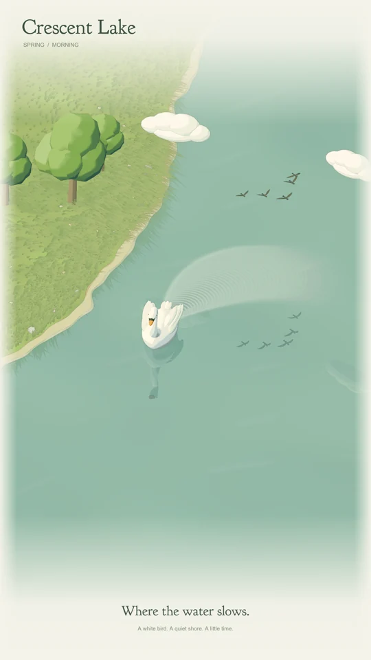

<h1 align="center">Crescent Lake</h1>

<p align="center">用代码画一片安静的湖。</p>

<p align="center">
  <a href="README.md">English</a> · <strong>简体中文</strong> · <a href="https://www.behance.net/gallery/257725777/Crescent-Lake">Behance</a>
</p>

<p align="center">
  <a href="https://github.com/EuanTop/Crescent-Lake/actions/workflows/ci.yml"></a>
  <a href="LICENSE"></a>
</p>

<p align="center">
  
</p>

一幅可交互的 WebGL 数字艺术：白天鹅、风中的草岸，以及原创生成式配乐。使用 **Three.js、TypeScript、GLSL 和 Web Audio** 构建。

- 24 秒循环：Morning → Golden Hour → Morning。
- 程序化草地、云鸟、倒影和持续扩散的尾迹。
- 三种配色、六种着色风格，右侧面板可收起。
- 原生 4K 视频与逐帧无损 RGB / PCM 母版。

## 运行

需要 **Node.js 22.12+** 和支持 **WebGL 2** 的浏览器。

```sh
npm ci
npm run dev
```

打开 `http://127.0.0.1:5173/`。默认竖屏 9:16；点击 **=** 调节场景，配乐需手动开启。

```sh
npm test
npm run build
```

## 导出

| 内容 | 竖屏规格 | 格式 |
| --- | --- | --- |
| 无损母版 | 2160 × 3840 · 30 fps | FFV1 RGB + PCM · MKV |
| 4K 视频 | 2160 × 3840 · 30 fps | H.264 + AAC · MP4 |
| HD 视频 | 1080 × 1920 | 浏览器 MP4 / WebM |

无损导出需要本地开发服务及 **PATH 中的 FFmpeg**。程序逐帧渲染，生成无损母版和分享版，成片不含控件。导出内容保存在已被 Git 忽略的 `artifacts/`；仓库仅保留一张 README 小尺寸预览图。

## 更多

[导出说明](docs/EXPORT.md) · [渲染实现](docs/PAINTERLY.md) · [声音设计](docs/SOUND-DESIGN.md) · [参与贡献](CONTRIBUTING.md)

[复现作品的提示词](docs/prompts/recreate-crescent-lake.md)。

## 许可

项目代码和原创场景资产采用 [MIT](LICENSE)。Goudy Bookletter 1911 字体保留[上游许可声明](public/fonts/OFL.txt)。详见[第三方声明](THIRD_PARTY_NOTICES.md)。
